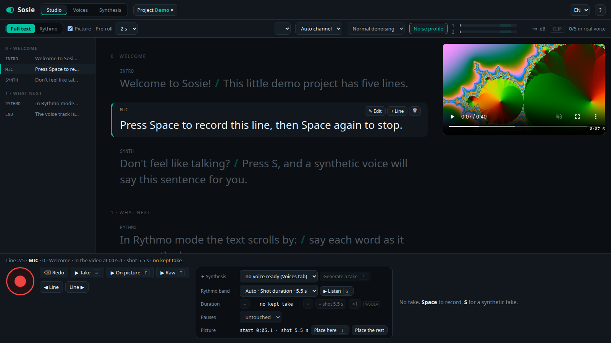

<p align="center"></p>

<h1 align="center">Sosie</h1>

<p align="center"><b>Your voice double.</b> Record a voice-over line by line, clone your voice from 30 seconds of speech,<br/>and make it say anything. Everything runs on your own machine.</p>

<p align="center"></p>

---

**Contents** · [What it does](#what-it-does) · [Requirements](#requirements) · [Install](#install) · [First steps](#first-steps) · [The studio](#the-studio) · [Voices](#voices) · [Synthesis](#synthesis) · [Projects and files](#projects-and-files) · [Command line](#command-line) · [Troubleshooting](#troubleshooting) · [How it works](#how-it-works) · [Ethics](#ethics) · [Roadmap](#roadmap) · [Credits](#credits)

## What it does

Sosie is a voice-over studio in your browser, with a cloned voice built in.

- **Record a script, line by line.** Paste a script, or import a text, Markdown, SRT or JSON file. Each line gets as many takes as you want; the best one is *kept* and goes into the voice track. Whisper tells you what you actually said, word by word: you can stray from the script.
- **Dub on the picture.** Load a video, place each line on it, and record on a **rythmo band**, the dubbing band that scrolls the words across a bar at the pace of a reference (your previous take, a synthetic voice, the shot's duration, or a pace you set).
- **Clean takes without an audio editor.** Each kept take is trimmed, denoised against a recorded room-noise profile, gently compressed and levelled to −20 LUFS. Shorten the pauses inside a take, make it faster or slower without changing the pitch, fit it to the shot in one click.
- **Fix a passage instead of redoing the take.** Select words in a take, then delete them, replace them with the synthetic voice, or re-record only them. Cut a line in two, audio included.
- **Clone a voice.** A guided protocol records ten sample sentences and builds the 30-second reference the clone imitates. Or import a recording, or use the takes of a project.
- **Generate speech.** Type a text, pick a voice, get a clip: each sentence is drawn several times and checked by Whisper, the best draw is kept. Download it, copy it to the clipboard, or drag it out.
- **A voice track for the edit.** One WAV per line (48 kHz, 16-bit), with `durations.json` and `words.json` (every word with its timing): an editing script, a subtitle tool or an animation can follow the voice word by word.

The interface is in English and French. Synthesis runs [Chatterbox Multilingual V3](https://github.com/resemble-ai/chatterbox) (23 languages); speech recognition runs [faster-whisper](https://github.com/SYSTRAN/faster-whisper).

## Requirements

| | Studio only | Studio + voice cloning |
|---|---|---|
| System | Linux or macOS (Windows: through WSL2) | Linux, ideally |
| Python | 3.10 to 3.12 (the installer brings its own) | same |
| GPU | not needed | NVIDIA with CUDA, 8 GB of video memory or more (the CPU works, at a crawl) |
| Disk | ~2 GB (Whisper turbo) | ~14 GB (PyTorch with CUDA 6 GB, models 7.5 GB) |
| Tools | `ffmpeg`, `git`, `curl` | same |
| Browser | Chrome or Chromium advised (app window, microphone access) | same |
| Microphone | any; an audio interface and a condenser microphone for real voice-over | same |

## Install

### The one-liner

```sh
curl -fsSL https://raw.githubusercontent.com/damienlaine/sosie/main/install.sh | bash
```

Then start Sosie with `sosie` (or *Sosie* in your applications menu on Linux).

The installer:

1. checks for `git`, `ffmpeg` and `curl`, and tells you how to install what is missing;
2. installs [uv](https://docs.astral.sh/uv/), the Python package manager, if you don't have it;
3. downloads Sosie into `~/.local/share/sosie/app` (or uses the clone it is run from);
4. creates a Python 3.11 environment in `.venv` and installs Sosie with voice cloning (PyTorch with CUDA, Chatterbox);
5. downloads the models into the Hugging Face cache (`~/.cache/huggingface`): Whisper large-v3-turbo for the takes, Chatterbox Multilingual V3 and Whisper large-v3 for the synthesis;
6. creates a five-line demo project in `~/sosie/demo-en` (or `demo-fr`);
7. links the `sosie` command into `~/.local/bin`, and adds a menu entry on Linux.

Options, after `bash -s --` in the one-liner or on `./install.sh`:

| option | effect |
|---|---|
| `--no-synthesis` | the recording studio only: no PyTorch, no GPU, ~2 GB instead of ~14 GB |
| `--no-models` | install the software now, download the models later with `sosie setup` |
| `--dir PATH` | where to put Sosie (default `~/.local/share/sosie/app`) |
| `--lang fr` | the demo project in French (default: your system's language) |
| `--no-desktop` | no menu entry |

Run the installer again at any time to update Sosie.

### By hand

```sh
git clone https://github.com/damienlaine/sosie && cd sosie
uv venv --python 3.11
uv pip install -e ".[voice]"        # or: uv pip install -e .   for the studio only
.venv/bin/sosie setup                # the models and the demo project
.venv/bin/sosie                      # the studio
```

Without uv: `python3.11 -m venv .venv && .venv/bin/pip install -e ".[voice]"`.

### Windows

Use [WSL2](https://learn.microsoft.com/windows/wsl/install) with Ubuntu, then the one-liner inside it. The studio opens at `http://localhost:8777` in your Windows browser. GPU synthesis in WSL2 needs the NVIDIA driver for WSL.

## First steps

1. **Start Sosie**: `sosie demo`. A browser window opens on the demo project: five lines, each telling you what to try.
2. **Enable the microphone** when asked (Sosie never uses echo cancellation, noise suppression or automatic gain: raw audio only). Pick it in the top bar, and check the level meter while you speak: peaks in the light zone, never the red CLIP badge.
3. **Record the noise profile**: *Noise profile*, then 10 seconds of silence. Sosie subtracts that background noise from the exported takes.
4. **Record a line**: `Space` to start, `Space` to stop. The take appears at the bottom, is analysed by Whisper in a few seconds, and is kept. `⌫` throws it away and records again at once.
5. **Listen**: `⏎` plays the kept take as it goes into the track; `T` plays the raw recording.
6. **Generate a synthetic take**: press `S` on a line (you need a voice first: see [Voices](#voices)).
7. **Find your voice track** in the project's `export/` folder (*Project ▸ Voice track* shows the path).

`?` lists every keyboard shortcut.

## The studio

### Projects

*Project* (top bar) opens the project panel: recent projects, a new project from a pasted script or a file, a folder browser, and for the open project its folders, *Edit the script*, *Choose a video…* and *Synthetic takes* for all lines at once. Everything is saved as you go; a project is a plain folder you can copy or archive.

### Lines

The left column lists the lines (by chapter). On the current line:

- **✎ Edit** (`E`): change its text and its **ID** (its name: takes, export and placement follow a rename), or **✂ Cut at the cursor** to split it in two. If it has a kept take, the take is split at the same place, in the silence between the two words.
- **+ Line**: add a line after it (its ID is chosen for you if you leave it empty).
- **🗑**: delete it (two clicks; its takes stay on disk).

### Takes

Each line has microphone takes (🎙) and synthetic takes (✦). One is **kept** (★): that one goes into the track. Recording a new take keeps it; a synthetic take is kept only if the line has none yet. Click ★ on another take to keep it instead; click *★ kept* twice to keep none.

On a take: **▶** plays it as in the track (kept take) or raw, **▶ raw** the recording as it is, **✂ Edit** opens the take editor, **▶ picture** plays it on the video. The waveform shows the speech in green, the pauses in orange, what is removed in red.

### The take editor

**✂ Edit** on a take (or `X`) shows its waveform and the words Whisper heard. Click a word, Shift+click another to select a passage, then:

- **Delete the passage**;
- **Replace with synthesis**: the text is filled in with the selected words, change it at will, pick the voice;
- **Replace by recording**: say only the passage (`Space` or ■ to stop); the new recording is brought to the level of the take;
- **Cut the line** before the passage: the rest becomes a new line, with its part of the take.

Cuts fall in the silences between words (the quietest instant nearby, with short crossfades). Every change makes a new take, kept; the previous one stays in the list, so nothing is lost.

### The tools panel

| row | what it does |
|---|---|
| ✦ Synthesis | the voice for synthetic takes, and *Generate a take* (`S`) |
| Rythmo band | where the band gets its rhythm (below), *▶ Listen* (`G`); with *Pace*, set the line's words per minute (−/+), reset it (↺) or apply it to the whole project (⇉) |
| Duration | make the kept take shorter or longer by 2 % steps, fit it to the shot (= shot) or to the synthesis (= synthesis), back to ×1. WSOLA, pitch unchanged |
| Pauses | cap every pause of the kept take (≤ 0.5 / 0.3 / 0.15 s), or click a pause on its waveform to remove it (click again to bring it back) |
| Picture | where the line starts in the video: *Place here* (`I`) at the video's current time, *Place the rest* to chain the following lines by their estimated duration |

### The rythmo band

*Full text* shows the whole script; *Rythmo* (`M`) scrolls the current line across a bar. Its rhythm comes from the source you choose:

| source | timing |
|---|---|
| Kept take | the words Whisper heard in your kept take, with their times (redo a take at the same pace) |
| Synthesis | the words of the latest synthetic take |
| Imported synthesis | an existing voice track set as the project's `guide` folder |
| Shot duration | the line spread over its shot in the video |
| Pace | the line spread at a pace in words per minute: the line's own, else the project's (measured on your kept microphone takes once there are 3, else 147) |

*Auto* takes the first available among synthesis, imported synthesis, kept take, shot, pace. With a video, the band follows the picture and the *Pre-roll* starts it a little early; `+`/`−` change the scrolling speed.

### Video

*Project ▸ Choose a video…* loads any video Chrome plays (MP4/H.264, WebM…). Lines are then placed one after the other from 0:00; move the video to where a line starts (its own controls, under the picture) and press `I`. Importing a script as SRT places every line at its cue. The *Picture* checkbox (`V`) hides the video.

### Export

The kept take of each line is written to `export/<id>.wav` (48 kHz, 16-bit, mono): trimmed to the speech with 0.1 s before and 0.3 s after, denoised (none / light / normal / strong: up to 8, 14 or 20 dB of reduction), high-passed at 70 Hz, gently compressed, at −20 LUFS with peaks under −1.5 dBFS, then pauses shortened and tempo applied. `durations.json` and `words.json` are updated at once. Raw takes are never modified.

## Voices

The *Voices* tab is the library. Each voice is a 30-second reference recording plus its settings.

**New voice**: give it a name and a language; ten sentences to read are proposed (French and English; write your own for another language). The voice opens in the studio as a small project: record the noise profile, read each sentence the way the voice should sound, keep the best take of each, then **Build the voice**. The full protocol, and why each rule matters, is in [docs/voice-protocol.md](docs/voice-protocol.md). In short:

- record in the language the voice will speak: **the accent comes from the reference**;
- read naturally, at the pace and energy you want: **the clone copies the delivery**;
- **the first sentence matters most**: the text model only hears the first 6 seconds of the reference;
- 30 seconds of clean speech; the reference is cut there.

Other ways to make a reference: **Import a recording** (any audio file, a single voice), or **From the open project** (its kept takes, glued together).

**Settings** of a voice (*Settings* on its card), used by the synthesis panel and synthetic takes:

| setting | default | effect |
|---|---|---|
| Exaggeration | 0.35 | emphasis and energy; higher is more theatrical, and faster |
| Guidance (cfg) | 0.3 | lower is slower and calmer; higher is faster and closer to the reference |
| Temperature | 0.6 | variety between draws; too high and the voice slips |
| Decoder reference | 30 s | how much of the reference the decoder hears (the timbre) |
| Tempo | 1.00 | speed change after generation, pitch unchanged (1.15 if the clone speaks slower than you) |
| Watermark | on | Resemble AI's inaudible Perth watermark in generated audio |

## Synthesis

The *Synthesis* tab turns a text into a clip with a voice of the library.

- **Draws** (1 to 5) and **Check with Whisper**: each sentence is generated up to N times and transcribed; draws that miss a word, invent words, stop for long or run away are rejected, and the draw closest to the real voice wins. One draw without the check is the fastest.
- **Advanced settings**: the voice's settings for this clip; *Save as the voice's settings* keeps them.
- **Clips** are kept in `~/.local/share/sosie/clips/`: ▶ to play, *⬇ WAV* to download, *📋 Copy* to put the file in the clipboard (paste it in a file manager, a chat, an editor), drag a clip out of the page to drop the file, ↺ to reuse its text and settings.
- `Ctrl+Enter` generates.

**Prosody.** There is no SSML. Punctuation does the work: `,` `.` `?` `!` place pauses and intonation, `?` raises the end of a sentence; each sentence is generated on its own and joined with a 0.40 s pause (0.45 s after `?`). The model turns `…`, `:`, `;` and ` - ` into commas: an ellipsis makes no long pause. Numbers are read out in words. A word misread? Write it as it sounds, or add a rule to the project's `lexicon.json`. Non-verbal tags such as `[sigh]` or `[laughter]` exist in the model's vocabulary but are undocumented for this model and mostly ineffective; some (`[inhale]`, `[um]`) can make a draw run away (the Whisper check rejects it).

## Projects and files

```
<project>/                     any folder
  sosie.json                   name, language, kind, optional video ("film") and paths
  script.json                  {"chapters": [{"title": …, "lines": [{"id": …, "text": …}]}]}
  timing.json                  where lines sit in the video: {id: {"start", "dur", "vo"}} (seconds)
  takes/<id>/tNN.wav + .json   every take (24-bit) and its analysis: words heard with times, speech bounds, pauses, edits
  selection.json               the kept take of each line
  settings.json                input channel, denoising, pace
  noise.wav                    the background noise profile
  todo.json                    optional: lines to record first, in order
  lexicon.json                 optional pronunciation rules (below)
  guide/                       optional imported synthesis (a voice track folder)
  export/                      the voice track: <id>.wav, durations.json, words.json
  trash/                       discarded takes (nothing is ever erased)

~/.local/share/sosie/          (or $SOSIE_HOME)
  voices/<id>/                 ref.wav, sosie.json (settings), and the voice's sample project
  clips/                       synthesis clips: <id>.wav + .json
  recent.json                  recent projects
  trash/                       deleted voices and clips
```

**Script files.** *Text or Markdown*: one paragraph per line, `# Title` starts a chapter, `[ID] text` names a line (IDs are letters, digits, `-` and `_`; otherwise `L001`, `L002`…). *SRT*: one line per cue, with its timing. *JSON*: `{"chapters": […]}` as in `script.json`, or `{"lines": [{"id", "text"}]}`.

**A voice track folder** (`export/`, `guide/`, and the output of `sosie render`): `<id>.wav`, `durations.json` = `{id: {"text", "dur", "src", …}}`, `words.json` = `{id: [{"t": word, "s": start, "e": end}, …]}`, one entry per word of the text.

**Pronunciation** (`lexicon.json` in a project, or `"lexicon"` in a voice's settings):

```json
{"rules": [["\\bSosie\\b", "Sozi"], ["\\bGIF\\b", "jiff"]], "spell": ["API", "SQL"]}
```

`rules` are regular expressions applied in order; words in `spell` are read letter by letter.

**Paths.** Any project folder can be redirected in `sosie.json`, so an existing production keeps its own layout:

```json
{"paths": {"takes": "takes", "trash": "trash", "noise": "noise.wav", "todo": "todo.json",
           "guide": "../assets/vo/fr-guide", "export": "../assets/vo/fr", "timing": "timing.json"}}
```

## Command line

```
sosie [PROJECT]                     the studio (the last project if none); reuses a running Sosie
sosie demo [--lang fr|en]           the studio on the demo project
sosie setup [--no-synthesis]        download the models, create the demo project
sosie init DIR --script FILE        new project from a script; --lang, --name, --film VIDEO, --format txt|md|srt|json
sosie say "Text." --voice ID        a sentence to a WAV file; --out, --lang, --tries, --no-check, --exaggeration, --cfg-weight, --temperature, --tempo
sosie render PROJECT --voice ID     every line of a project in a voice (a voice track folder); --out, --only A,B,C, --tries, --seed, --no-resume
sosie tempo SRC DST 1.15            speed a voice track folder up or down (WSOLA), word timings included
sosie voice list                    the library
sosie voice add NAME --lang fr [--ref sample.wav]
sosie voice import ID sample.wav    a new reference from a recording
sosie voice from-project ID --project DIR [--ids A,B,C]
```

`sosie studio` options: `--port` (8777), `--no-browser`, `--whisper` (the speech model for takes, `large-v3-turbo`), `--device` (`cuda`, `cpu`). `sosie render` skips the lines already made with the same text, reference and tempo: run it again after editing a script, only the changes are redone.

**Environment**: `SOSIE_HOME` (the data folder), `HF_TOKEN` (faster model downloads), `HF_HOME` (where models are cached).

## Troubleshooting

| symptom | what to do |
|---|---|
| *Microphone unavailable* | Chrome asks once per site: allow `localhost`. Check the input in the top bar, and that no other app holds the device. With an audio interface, pick its input (channel *Input 1/2* if the level shows on the other one). |
| No sound from a condenser microphone | it needs phantom power (48 V) from the audio interface |
| The level is low or clips | adjust the gain on the interface: peaks between −18 and −6 dBFS |
| `Address already in use` | Sosie is already running: `sosie` opens it; or use `--port` |
| Synthesis is very slow | no CUDA GPU was found (`sosie setup` prints the GPU it sees); install the NVIDIA driver, or use one draw without the check |
| `CUDA out of memory` | another program uses the GPU (another Sosie, another model): close it; the panel's model can be unloaded by restarting Sosie |
| Downloads are slow or rate-limited | set `HF_TOKEN` (a free Hugging Face token) and run `sosie setup` again |
| *Copy* does nothing (Linux) | install `wl-clipboard` (Wayland) or `xclip` (X11); or drag the clip out of the page |
| The video does not play | Chrome needs H.264/AAC MP4 or WebM: `ffmpeg -i in.mov -c:v libx264 -c:a aac out.mp4` |
| A word is cut in an edited take | undo by keeping the previous take (★), then select one word more |

The server log is in the terminal Sosie was started from.

## How it works

- **The server** is plain Python (`http.server`): it binds to `127.0.0.1` only, refuses requests whose `Host` is not local, and requires an `X-Sosie` header on every change (a web page from elsewhere cannot send it without a CORS preflight, which is never granted).
- **The page** is vanilla JavaScript, no build step. An AudioWorklet captures the microphone raw; each take keeps the microphone's input (the chosen one, or the loudest) as a 24-bit WAV, uploaded as the take ends.
- **Takes** are analysed on the CPU by faster-whisper large-v3-turbo (words with timings, the end of a take re-transcribed if Whisper dropped it), speech bounds come from the energy within the recognised words, pauses from the energy.
- **Denoising** is a spectral subtraction of the recorded noise profile, re-levelled on the silence before the first syllable, smoothed in time and frequency, capped at the chosen reduction.
- **Synthesis** runs Chatterbox Multilingual V3 on the GPU with the whole 30-second reference given to the decoder; every sentence is drawn several times and scored by Whisper large-v3 (missing common words, invented runs, long silences, implausible rate), ties broken by speaker similarity to the reference.
- **Speed changes** use WSOLA (ffmpeg `atempo`): phase-vocoder stretchers (Rubber Band R2 and R3) made cloned voices sound metallic in listening tests.
- **Edits** never touch a take: they write a new take, and rebuild its words from the words already known plus those of the insert.

The tests (`uv pip install -e ".[dev]"`, then `pytest`) need ffmpeg but no model.

## Ethics

Clone your own voice, or a voice whose owner gave explicit consent, for a use they agreed to. Generated audio carries Resemble AI's inaudible [Perth](https://github.com/resemble-ai/Perth) watermark by default, so synthetic speech can be detected; it can be turned off per voice, for private use.

## Roadmap

- **Live voice conversion**: speak into the microphone, hear (or send to a call) the cloned voice, about 0.7 s behind. Measured feasible on an RTX 4090 laptop GPU: [docs/realtime.md](docs/realtime.md).
- A PyPI package, once Chatterbox Multilingual V3 is in a PyPI release.
- Export of a whole project as one archive; a multitrack export (one file per chapter).

## Credits

[Chatterbox](https://github.com/resemble-ai/chatterbox) (MIT) by Resemble AI, [faster-whisper](https://github.com/SYSTRAN/faster-whisper) (MIT) by SYSTRAN, [Whisper](https://github.com/openai/whisper) (MIT) by OpenAI, [num2words](https://github.com/savoirfairelinux/num2words) (LGPL), [pyloudnorm](https://github.com/csteinmetz1/pyloudnorm) (MIT), [uv](https://github.com/astral-sh/uv) by Astral, and [FFmpeg](https://ffmpeg.org).

## License

[MIT](LICENSE) © 2026 Damien Laine
